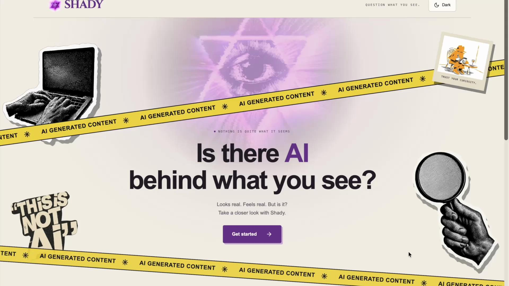
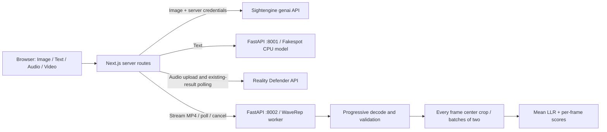

<div align="center">
  
  <h1>Shady</h1>
  <p><strong>Is there AI behind what you see?</strong></p>
  <p>Explore signs of AI generation in images, English text, speech, and video.</p>
  <p>Next.js · TypeScript · Tailwind CSS · FastAPI · PyTorch</p>
</div>

[](docs/media/shady-demo.mp4)

**[Watch the 2m 34s demo →](docs/media/shady-demo.mp4)** · [Setup](#run-locally) · [Architecture](#architecture) · [Limits & benchmarks](#limits--benchmarks) · [Credits](#credits--licensing)

Shady is a noncommercial portfolio project combining a custom frontend, server-side API integrations, and locally running detection models. It brings four analysis workflows into one responsive interface, with warm ivory/light and dark themes, accessible controls, and honest model-result explanations.

**A signal to investigate—not proof of authenticity or authorship.** Shady integrates existing detection models; it does not train or claim ownership of them. No live deployment is required to explore the source or run it locally.

## Four ways to take a closer look

| Mode | Detection engine | What Shady shows |
| --- | --- | --- |
| **Image** | Sightengine `genai` API | Actual AI-generation confidence, image preview, and a real 2× magnifying-glass animation while analysis is pending. |
| **Text** | Local Fakespot RoBERTa | English Human/AI classification and the model's selected-class score; character/word counts and token validation. |
| **Voice** | Reality Defender API | Provider conclusion and manipulation score for supported speech recordings, with uploading/processing/completed states and playback. |
| **Video** | Local GRIP-UNINA WaveRep G4 | Every decoded frame's 504×504 center crop, official mean LLR, actual progress, a peak-preserving timeline, and paginated frame scores. |

- Drag and drop, accessible file pickers, previews, removal and reset controls.
- Light/dark switch on both pages; follows system preference until you choose, then remembers your choice locally.
- Server-only credentials, validated uploads, bounded request sizes, rate limits, duplicate-submission guards, and explicit errors.
- CPU inference for text/video with pinned model revisions. No paid inference subscription is needed for these local models, but downloads, storage, RAM, CPU time and any hosting still have costs.
- No fabricated results: missing keys or unavailable local models show **unavailable**.
- Video cancellation stops the worker and cleans temporary uploads. No silent truncation, inference sampling, or analysis of the soundtrack.

### About the recorded demo

The recording walks through images → text → voice → video → additional image checks. It is a **silent screen recording**, supplied by the project author; results shown are recorded examples, not hard-coded application responses.

The final collage returned a 65% image AI-generation confidence score. That does **not** mean 65% of its pixels were generated. An AI-image screenshot was also flagged in the recording; this demonstrates one successful screenshot test, not guaranteed screenshot detection. Synthetic and human speech examples illustrate the voice workflow, not an accuracy benchmark.

The current source includes additional preview reliability fixes made after the recording. [Text example](docs/media/text-analysis.jpg) · [Video example](docs/media/video-analysis.jpg).

## Architecture



The browser never receives provider keys or calls the Python services directly. Next.js proxies the private services. Video uploads stream through Next with backpressure instead of buffering multiple full-file copies. Python validates the complete clip, then scores it progressively in a startup-loaded, killable subprocess. One video job runs at a time.

| Directory | Responsibility |
| --- | --- |
| `app/` | Landing page, theme controls, four analysis interfaces and Next.js API routes |
| `lib/` | Provider adapters, validation, limits, polling, result parsing and display helpers |
| `text-service/` | Local Fakespot inference, reviewed text cleaning and model/license notices |
| `video-service/` | WaveRep adapter, complete decoding, worker lifecycle and upstream license/code |
| `tests/` | Mocked provider/service and browser-component tests |
| `scripts/` | Local service startup, model download and repository checks |
| `docs/` | Demo, screenshots and detailed engineering notes |

## Run locally

**Requirements:** Node.js 22 LTS, Python 3.12, Git, and sufficient disk/RAM for PyTorch and the models. A GPU is not required. Internet is needed for dependencies, initial model downloads and the external image/audio APIs.

### 1. Install the web app and set local credentials

Clone the repository, then install the web app:

```sh
git clone https://github.com/parrvchhibber54-source/Shady.git
cd Shady
npm ci
cp .env.example .env.local
```

Edit **`.env.local` on your computer**:

```dotenv
SIGHTENGINE_API_USER=your_api_user
SIGHTENGINE_API_SECRET=your_api_secret
REALITY_DEFENDER_API_KEY=your_reality_defender_api_key
FAKESPOT_SERVICE_URL=http://127.0.0.1:8001
WAVEREP_SERVICE_URL=http://127.0.0.1:8002
TRUST_PROXY=false
```

Get image credentials from the [Sightengine dashboard](https://dashboard.sightengine.com/) and audio credentials from your [Reality Defender account](https://app.realitydefender.ai/). Confirm your account's API/audio access, quota, billing and retention terms. Never paste keys into issues, client code or screenshots. Never prefix keys or service settings with `NEXT_PUBLIC_`. Restart Next after editing credentials.

Image and audio analysis require their respective keys. Text and video can run without those keys once their local services are set up. Keep `TRUST_PROXY=false` unless your trusted proxy overwrites forwarded IP headers.

### 2. Install the local Python environment

```sh
python3.12 -m venv .venv
.venv/bin/python -m pip install --upgrade pip
.venv/bin/python -m pip install -r video-service/requirements.lock.txt
```

The video lockfile includes text-service dependencies. If you only need text, install `text-service/requirements.lock.txt` instead. On Windows, use `.venv\Scripts\python.exe` and the equivalent terminal commands. On Linux, a CPU-only Torch installation can avoid unnecessary CUDA packages; keep Torch 2.7.0 and Torchvision 0.22.0 compatible. The pinned environment was exercised on macOS ARM64; wheel availability and memory requirements vary by platform.

Model weights and environments are **not** committed. The Fakespot service downloads its pinned model/tokenizer on first startup and uses `.runtime/huggingface`. For video, review the [WaveRep license](video-service/upstream/LICENSE.md), then download and verify the G4 checkpoint:

```sh
.venv/bin/python scripts/setup-video.py
```

The G4 checkpoint is about 330 MiB. Allow several GB of disk for the environment, models and caches, and several GB of available RAM for the combined services. Measure on your hardware before increasing concurrency.

### 3. Start three terminals

```sh
# Terminal 1: web app
npm run dev

# Terminal 2: English text detector
sh scripts/text-service.sh

# Terminal 3: video detector
sh scripts/video-service.sh
```

Open **http://127.0.0.1:3000**. Health endpoints: **http://127.0.0.1:8001/health** and **http://127.0.0.1:8002/health**. Reload the analysis page after a Python service becomes ready. The scripts bind services to loopback, not your public network. Stop each with Ctrl+C.

For a production-style local run, use `npm run build` then `npm start` instead of `npm run dev`, keeping the Python services separate.

## Limits & benchmarks

| Input | Current application limits |
| --- | --- |
| Image | Still JPEG, PNG or WebP; up to 8 MiB and 25 million decoded pixels. |
| Text | English prose; up to 10,000 UTF-16 code units and 512 tokens **after cleaning**, including special tokens. Excess input is rejected, never truncated. |
| Voice | Standard uncompressed 16-bit PCM WAV, mono/stereo, 8–48 kHz, 1.5–60 seconds, up to 10 MiB. No microphone recording or URL import. |
| Video | MP4 with one H.264 video track; up to 120 seconds, 100 MiB, 60 fps, 7,200 frames and a 1920×1080 pixel budget per frame. No silent transcoding or skipped frames. |

Video's frame rule is the publisher's **LLR > 0**. The overall score is the arithmetic mean of **all** frame LLRs. Its sigmoid is a transformed score, **not** a calibrated authenticity probability. Positive-frame sections and local peaks remain visible even when the overall mean is negative. The chart uses a display-only extrema envelope; the frame table preserves every score with 50 rows per page.

Real CPU smoke measurements on an Apple M5 Pro with 24 GiB RAM, using non-sensitive generated clips:

| Clip | Frames scored | Last timestamp | Processing time |
| --- | ---: | ---: | ---: |
| 8 seconds at 4 fps | 32/32 | 7.75 s | 13.0 s |
| 12 seconds at 30 fps | 360/360 | 11.9667 s | 146.2 s |
| 120 seconds at 1 fps, through Next upload/poll | 120/120 | 119 s | 48.5 s |

**Two-minute 30/60-fps real inference was not benchmarked.** Linear extrapolation from the denser run suggests roughly 24–49 minutes on that machine; this is an estimate, not a completed test or guarantee. The worker has a two-hour deadline, bounded batches of two and one active job. Polling is bounded at 7,260 seconds, with a 7,440-second overall browser deadline. Cancelling kills the worker before deleting its temporary input.

A 120-second/60-fps/7,200-frame decoder boundary was tested with lightweight fixtures; routine inference tests are mocked. These checks demonstrate implementation behavior, **not model accuracy**.

## Privacy, costs & deployment

- Images are sent to **Sightengine** and audio to **Reality Defender** only after explicit submission. Text and video go to your configured Python services. Review provider policies before using sensitive material; Shady makes no blanket zero-retention promise for external providers.
- Shady does not intentionally persist submitted text or image/audio uploads. Video uses temporary files under `.runtime/video-tmp`, removed on completion, failure or cancellation; leftovers from a crash are cleaned on the next startup. Preview URLs are revoked. OS swap, crash dumps and infrastructure logging need separate controls.
- Image/audio usage is subject to account quotas and provider billing. There are no automatic retries of new chargeable submissions. Polling retrieves an existing analysis. Application rate limits are not account-wide spending caps.
- The audio UI references an advertised free-plan quota; confirm your current plan in the provider dashboard. Pricing, quotas and access can change. Local text/video do not need paid inference credits, but compute and hosting are not free resources.
- **Process-local jobs are not durable.** Restarting Next/Python or development hot reload can lose a video handle. There is no automatic resume or resubmission.
- A public deployment needs private hosted Python workers, authenticated service access, shared/durable job and rate-limit storage, supervision, and upload/time limits compatible with 100 MiB transfers. Visitors cannot reach your computer's localhost. Next.js hosting alone does not host the Python models. WaveRep's license also limits commercial deployment.

All detectors can miss generated material or flag genuine material. Voice analysis does not verify identity or truthfulness. Text detection is English only. Video assesses center crops, so it can miss evidence elsewhere, and does not inspect the soundtrack. Scores are not percentages of generated pixels, words or audio.

## Tests

```sh
npm test
npm run typecheck
npm run build
.venv/bin/python -B -m pytest text-service video-service/test_video.py -q -p no:cacheprovider
python3 scripts/check-repo.py
python3 -B -m unittest discover -s tests -p 'test_repo_guard.py'
```

Routine tests mock providers and inference, so they do not consume paid scans or download weights. Coverage includes upload validation, cached-image magnifier startup, narrow-image geometry, provider/result errors, true zero scores, duplicate submissions, polling deadlines, cancellation/cleanup, full-frame aggregation, boundary limits, theme preference, and paginated rendering.

JavaScript checks run in GitHub Actions on pushes and pull requests. Python tests also run with CPU-only Torch. See [validation records](VALIDATION.md) and [engineering notes](docs/engineering-notes.md) for measurements and historical implementation detail.

## Credits & licensing

Shady is the frontend/backend integration and portfolio application—not the detection model author.

- **Sightengine:** image `genai` API; usage is subject to its service terms.
- **FakespotAI / Mozilla:** [`fakespot-ai/roberta-base-ai-text-detection-v1`](https://huggingface.co/fakespot-ai/roberta-base-ai-text-detection-v1), Apache-2.0. Reviewed cleaning code and original license/notice are in [`text-service/`](text-service/NOTICE.md).
- **Reality Defender:** synthetic/manipulated speech detection API; usage is subject to account/service terms.
- **GRIP-UNINA WaveRep:** Corvi, Cozzolino, Prashnani, De Mello, Nagano and Verdoliva, *Seeing What Matters: Generalizable AI-generated Video Detection with Forensic-Oriented Augmentation* (NeurIPS 2025). **Informational/nonprofit use only; unauthorized industrial/profit-oriented use is prohibited.** Preserve the [original license](video-service/upstream/LICENSE.md) and [attribution](video-service/NOTICE.md).
- **Cinzel:** font used under the [SIL Open Font License](public/fonts/OFL-Cinzel.txt).

See [THIRD_PARTY_NOTICES.md](THIRD_PARTY_NOTICES.md). Public availability does not remove third-party restrictions or grant blanket commercial rights. No repository-wide permissive license is asserted over the included third-party code, model assets or artwork.
